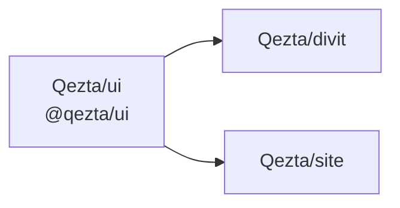

<div id="top">
    <div align="center">
        
        <p>The Qezta torus logo, including its animated version, is a trademark of Qezta.</p>
        <h1 align='center'>ui</h1>
        <strong>Shared Svelte component library and design system for Qezta org sub-products</strong>
    </div>

</div>

---

<div align='center'>
    <a href="https://github.com/Qezta/ui/stargazers">
        
    </a>
    <a href="https://github.com/Qezta/ui/">
        
    </a>
    <a href="https://github.com/Qezta/ui/blob/main/LICENSE">
        
    </a>
    <a href="https://github.com/nixos/nixpkgs">
        
    </a>
    
</div>

---

<div align='center'>
    <a href="https://github.com/Qezta/ui/actions/workflows/flake-check.yml">
        
    </a>
</div>

---

## Contents

- [Overview](#overview)
- [Consumers](#consumers)
- [Usage](#usage)
- [Peer dependencies](#peer-dependencies)
- [License](#license)

---

## Overview

Shared Svelte component library and design system for Qezta org sub-products
(divit.qezta.com, qezta.com).

Consumed as a git dependency — not published to npm.

## Consumers



Both sites pin this repository by commit (`github:Qezta/ui#<sha>`) and are
deployed on Vercel from their own repositories, so bump the pin there after
changing a component.

## Usage

In a consumer's `package.json`:

```json
{
  "dependencies": {
    "@qezta/ui": "github:qezta/ui#v0.1.0"
  }
}
```

Pin to a git tag for reproducibility. Available exports:

- `@qezta/ui/components/atoms/*` — `Cursor`, `Image`, `Title`, `Social`, `SourceLink`, `TouchCursor`, `SectionHeader`
- `@qezta/ui/components/molecules/*` — `About`, `Socials`
- `@qezta/ui/components/organisms/*` — `Card`, `Chatbot`, `Metrics`, `Terminal`
- `@qezta/ui/cursor` — `burst`, `scale` Svelte stores
- `@qezta/ui/styles/{global,fonts}.scss`

## Peer dependencies

Consumers must provide `svelte ^3.59.2` and `three ^0.178.0`.

## License

MIT — see [LICENSE](./LICENSE).

<div align="right">

[![][back-to-top]](#top)

</div>

[back-to-top]: https://img.shields.io/badge/-BACK_TO_TOP-151515?style=flat-square&color=purple
